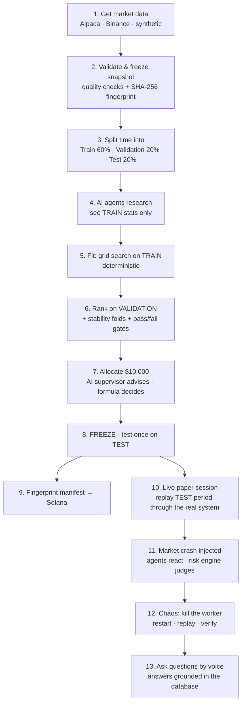

# QuantSwarm, Explained

*A complete guide for someone who has never worked in trading: what the app does, how every piece fits
together, the pipeline from raw data to verified results, and an honest scorecard against the Lucera
Trading Systems Challenge.*

---

## Contents

1. [The 30-second version](#1-the-30-second-version)
2. [Trading 101: the ideas you need](#2-trading-101-the-ideas-you-need)
3. [What QuantSwarm is: a tiny trading firm in software](#3-what-quantswarm-is-a-tiny-trading-firm-in-software)
4. [The problem it solves](#4-the-problem-it-solves)
5. [The parts of the system](#5-the-parts-of-the-system)
6. [The pipeline, step by step](#6-the-pipeline-step-by-step)
7. [The life of a single order](#7-the-life-of-a-single-order)
8. [The safety promises (invariants) in plain English](#8-the-safety-promises-invariants-in-plain-english)
9. [How we prove it and how we measure it](#9-how-we-prove-it-and-how-we-measure-it)
10. [Real results](#10-real-results)
11. [Sponsor integrations](#11-sponsor-integrations)
12. [Running it and the 5-minute demo](#12-running-it-and-the-5-minute-demo)
13. [Scorecard against the Lucera track](#13-scorecard-against-the-lucera-track)
14. [Honest limitations](#14-honest-limitations)
15. [Questions judges will probably ask](#15-questions-judges-will-probably-ask)
16. [Project status (P1 / P2 / P3)](#16-project-status-p1--p2--p3)

---

## 1. The 30-second version

QuantSwarm lets **AI agents act like traders**: they study market data, invent trading strategies, compete
against each other, and place orders with **$10,000 of pretend money**.

AI is creative, but it is also unreliable. It can be overconfident, buggy, or simply wrong. So the AI
**never touches the money directly**. Every order goes through a separate, strict, boring piece of software
(the *execution engine*) that checks risk rules, simulates the trade, and writes it into a tamper-evident
ledger. That engine is built to survive duplicate requests, simultaneous requests, garbage input, and
being force-killed mid-operation, **without ever losing or inventing a single cent.**

> **One sentence:** *the AI proposes, the engine disposes, and the engine can prove it never made a mistake.*

Everything is simulated ("paper trading"). No real money, no real broker.

---

## 2. Trading 101: the ideas you need

You only need about fifteen concepts. Each one shows up somewhere in the app.

### Markets and prices

| Term | Plain English | Where it appears |
|---|---|---|
| **Stock / symbol** | A share of a company, identified by a ticker: `AAPL` = Apple, `SPY` = a fund tracking the 500 largest US companies, `QQQ` = a fund tracking big tech. | The 5 symbols we trade: SPY, QQQ, AAPL, MSFT, NVDA |
| **Bar (candle, OHLCV)** | A summary of trading over one time slice: the **O**pen price, **H**igh, **L**ow, **C**lose, and **V**olume (shares traded). We use **1-hour bars**. | All market data |
| **Market data feed** | The stream of bars arriving over time. | Alpaca (real stocks), Binance (real crypto), synthetic data |

### Orders and trading

| Term | Plain English | Where it appears |
|---|---|---|
| **Order** | An instruction: "buy 10 shares of AAPL". | Every agent decision |
| **Market order** | "Buy now at whatever the price is." | Default order type |
| **Limit order** | "Buy only if the price is $190 or lower." | Supported |
| **Fill** | The order actually happening, at some price and quantity. | Simulated by the engine |
| **Partial fill** | Only part of the order happened (e.g. 6 of 10 shares). | When volume is thin or prices gap |
| **Slippage** | You wanted $100, you paid $100.05: the gap between expected and actual price. Real trading always has some. | 0.05% normally, 0.5% during a crash |
| **Position** | What you currently own (e.g. 12 shares of MSFT). | Per agent |
| **Long-only** | You may only buy things and later sell what you own. No **shorting** (betting on a fall by selling shares you don't have). | Enforced by rule R5 |
| **P&L** | Profit and loss. **Realized** = locked in by selling; **unrealized** = paper gain on what you still hold. | Dashboard |
| **Equity** | Cash + current value of everything you own. | Dashboard |

### Strategies and testing

| Term | Plain English |
|---|---|
| **Strategy** | A rule that turns price history into "how much should I own right now?" Example: *buy when the 20-hour average price rises above the 100-hour average.* |
| **Momentum / trend-following** | Bet that things moving up keep moving up. |
| **Mean reversion** | Bet that prices that moved too far snap back to normal. |
| **Volatility targeting** | Own less when the market is wild, more when it is calm. |
| **Backtest** | Replaying history to see how a strategy *would have* done. |
| **Look-ahead bias** | The #1 backtesting sin: accidentally letting the strategy see the future (e.g. using tomorrow's price today). It makes results look amazing and fake. |
| **Overfitting** | Tuning a strategy so perfectly to past data that it fails on new data. Like memorizing last year's exam answers. |
| **Train / validation / test split** | Splitting history into three time periods: **train** (tune the strategy), **validation** (compare strategies fairly), **test** (one final honest exam, used exactly once). |
| **Sharpe ratio** | Return divided by how bumpy the ride was. Higher is better. Above 1 is good, above 2 is very good, negative means losing. |
| **Max drawdown** | The worst peak-to-bottom drop. "At some point we were down 12% from our best." |

### Risk and infrastructure

| Term | Plain English |
|---|---|
| **Pre-trade risk check** | Rules checked *before* an order is allowed: is it too big? can we afford it? |
| **Kill switch** | An emergency stop that blocks new buying. |
| **Idempotency** | Sending the same request twice has the same effect as sending it once. Critical: networks retry, and you must never buy twice by accident. |
| **Ledger** | The official record of every money movement. |
| **Event sourcing** | Instead of only storing "balance = $9,500", store every event that happened ("bought 5 AAPL at $190") so the balance can always be rebuilt and audited. |
| **Hash chain** | Each record includes a fingerprint (SHA-256 hash) of the one before it, so changing any old record breaks every fingerprint after it. The same idea as a blockchain. |
| **Paper trading** | Simulated trading with fake money. |

---

## 3. What QuantSwarm is: a tiny trading firm in software

Picture a small trading firm. QuantSwarm recreates its roles in code:

| Role in a real firm | In QuantSwarm | Trusted? |
|---|---|---|
| **Researchers** who invent strategies | 3 AI agents (GPT-4.1-mini): *Momentum*, *Mean Reversion*, *Volatility* | ❌ Untrusted: may be wrong |
| **Portfolio manager** who decides who gets money | AI *Supervisor*, bounded by a strict *Allocator* formula | ⚠️ Advice only |
| **Risk & compliance desk** | The **risk engine**: 10 hard-coded rules (R0–R9) | ✅ Trusted, deterministic |
| **Exchange / execution** | The **fill simulator**: decides price and quantity of each trade | ✅ Trusted, deterministic |
| **Back office / accounting** | The **ledger**: integer-cent accounting, hash-chained events | ✅ Trusted, deterministic |
| **Auditor** | Independent replay + verification, plus a public fingerprint on the Solana blockchain | ✅ Verifiable by anyone |
| **Trading screen** | Next.js web terminal | Observer |

The key design idea is the **trust boundary**: everything AI-related sits *outside*, and can only talk to the
money through one narrow, validated door.

---

## 4. The problem it solves

Companies increasingly want AI agents that *take actions*: book things, move money, place trades. The
scary part is not "will the AI pick good stocks?" It is:

- What if the agent sends the same order **twice** because of a network retry?
- What if **three agents** spend the same shared cash **at the same moment**?
- What if an agent sends **nonsense** (buy −5 shares, a stock that doesn't exist, a price from last week)?
- What if the server **crashes halfway** through recording a trade?
- What if someone **edits the records** afterwards?
- What if the agent's strategy was secretly **cheating by looking at future data**?

QuantSwarm's answer is infrastructure where **none of those can corrupt the books**, plus automated tests that
attack each failure on purpose and show it holds. This is exactly the kind of system the Lucera track asks
for: *"simple, reliable, and scalable"* trading infrastructure with *"explicit correctness guarantees and
evidence that they hold."*

---

## 5. The parts of the system

```
   ┌────────────────────── UNTRUSTED (AI, can be wrong) ───────────────────────┐
   │  AI research agents  →  strategy tournament  →  live trading session      │
   │  (OpenAI + LangGraph)    (picks winners)          (sends orders over HTTP)  │
   └───────────────────────────────────┬────────────────────────────────────────┘
                                       │  HTTP: "buy 10 AAPL"
   ┌───────────────────────────────────▼────────────────────────────────────────┐
   │  API gateway: checks the request is well-formed, records it durably,       │
   │  recognizes retries, waits for the answer                                  │
   └───────────────────────────────────┬────────────────────────────────────────┘
                                       │  durable "to-do list" of commands (database table)
   ┌───────────────────────────────────▼────────────────────────────────────────┐
   │  EXECUTION WORKER (the only thing allowed to touch money)                  │
   │   risk rules → simulated fill → accounting → invariant check               │
   │   → ONE all-or-nothing database transaction → reply                        │
   └───────────────────────────────────┬────────────────────────────────────────┘
                                       │
   ┌───────────────────────────────────▼────────────────────────────────────────┐
   │  TimescaleDB (Tiger Data): commands, hash-chained ledger, positions,       │
   │  fills, equity history, market bars, telemetry, checkpoints                │
   └───────────────────────────────────┬────────────────────────────────────────┘
                                       │
            Web terminal (live dashboards)   ·   Solana Devnet (public fingerprints)
```

| Part | Folder | What it does | Why it's separate |
|---|---|---|---|
| **Ledger core** | `quantswarm/ledger/` | The rulebook: risk checks, fill simulation, accounting, invariant checks, replay. Pure code: no network, no clock, no randomness. | One rulebook used by *everything* (live trading, backtests, recovery, tests) so they can never disagree. |
| **Execution worker** | `quantswarm/execution/` | Pulls commands off the to-do list, runs them through the rulebook, saves results atomically. Exactly **one** worker per portfolio. | One writer means no race conditions; if it crashes, the API keeps accepting work. |
| **API gateway** | `quantswarm/api/` | Front door. Validates input, deduplicates retries, serves dashboards, independently re-verifies the ledger. | Lets the worker crash without losing requests. |
| **Backtester** | `quantswarm/backtester/` | Replays history through the **same** rulebook. | No "backtest-only" shortcuts that make results look better than reality. |
| **Strategies** | `quantswarm/strategies/` | 4 approved strategy *families*. AI picks the knobs, never writes code. | AI can't smuggle in arbitrary code or peek at the future. |
| **Agents** | `quantswarm/agents/` | AI researchers, tournament, live session, crash responses, Q&A. | Non-deterministic work kept strictly upstream. |
| **Audit** | `quantswarm/audit/` | Publishes result fingerprints to Solana; verifies them. | Third-party proof the results weren't edited later. |
| **Web terminal** | `apps/web/` | Live dashboards, adversarial buttons, event inspector, voice Q&A. | Observation only; uses the public API like anyone else. |

---

## 6. The pipeline, step by step



### Step 1: Get market data
Three sources:
- **Alpaca**: real US stock prices, 1-hour bars, Jan 2023 → Sep 2026 (free account).
- **Binance**: real Bitcoin 1-minute prices, used to stress-test speed (131,040 bars).
- **Synthetic**: generated, realistic-looking prices committed to the repo, so anyone can run the project
  with no accounts.

### Step 2: Validate and freeze
Data is checked (no duplicate timestamps, no impossible prices like low > high, no negative volume),
saved to a file, and given a **SHA-256 fingerprint**. Every later step records which fingerprint it used.
If the file is altered by even one byte, the system refuses to load it.

### Step 3: Split time
History is cut chronologically into **train (first 60%)**, **validation (next 20%)** and **test (last 20%)**.
This is how we fight overfitting: the strategy is tuned on one period and judged on a different one.

### Step 4: AI agents research (OpenAI + LangGraph)
Three AI agents run **in parallel**. Each sees only **training-period statistics** (returns, volatility,
how often prices are above their average, and so on), never validation or test data. Each must answer in strict
JSON: *which strategy family, which stocks, which parameter values to try, and why.* Answers are validated:
wrong family, unknown stock, or impossible parameters ⇒ one retry with the error, then fall back to a recorded
proposal. The AI can **only** choose from four pre-approved strategy families; it cannot write code.

### Step 5: Fit (deterministic)
For each agent, a plain grid search tries every parameter combination it suggested (up to 48) on the
**training** period and keeps the best. No AI here, so the step is reproducible.

### Step 6: Rank on validation
Each agent's tuned strategy is backtested on the **validation** period it has never seen, plus on three
"stability" slices of history. Pass/fail gates: at least 10 trades and a drawdown no worse than 25%.
Score = Sharpe × (1 − drawdown) × stability. **This is where overfitters get caught:** on the synthetic
dataset, the mean-reversion agent had the best training score (1.84) but failed validation (−0.03) and got $0.

### Step 7: Allocate the $10,000
The AI supervisor reads the scores and *suggests* weights. A fixed formula then decides:
- weights proportional to score;
- the supervisor can nudge each weight by at most ±20 percentage points;
- no strategy gets more than 40%;
- 10% always stays in cash;
- a strategy that failed its gates gets **zero**, whatever the AI says.

### Step 8: Freeze, then test once
Strategies and allocations are frozen. Only **then** is the held-out **test** period run, exactly once, and
reported honestly, even if negative. Everything (data fingerprint, AI proposals, parameters, scores,
allocations, test results, code version) goes into a **manifest** file.

### Step 9: Fingerprint on Solana
The manifest's SHA-256 hash is written to the Solana Devnet blockchain. Anyone can later recompute the hash
from the file and compare it to the chain. Change one number and it no longer matches.

### Step 10: Live paper-trading session
The test period is **replayed through the real running system**: prices are sent to the API like a market
feed, the frozen strategies turn them into orders, and every order travels the full production path
(API → command log → worker → risk → fill → ledger). The web terminal updates live. The session client
also deliberately re-sends some orders to imitate a flaky network.

### Step 11: Market crash
Halfway through, a scripted crash hits: prices fall 16% over 4 hours, volume triples, slippage widens.
Each AI agent is asked how to react ("buy the dip", "reduce", "hold"). Their answers become ordinary orders,
and the risk engine approves, shrinks or rejects them, with a rule code for each decision.

### Step 12: Chaos test
The judge kills the execution worker (`kill -9`) mid-session. Orders keep arriving; the API answers
"queued". On restart, the worker rebuilds the ledger from the event log (or from its latest checkpoint plus
the events after it), verifies every hash and the final fingerprint, then carries on. No trade is lost or
duplicated, and pressing **Replay & verify** in the UI shows the fingerprints match.

### Step 13: Ask questions
"Why was that order rejected?" or "Which agent did best?", typed or spoken. The answer is built from real
database rows; the AI only phrases it (and ElevenLabs can read it aloud). This path is read-only.

---

## 7. The life of a single order

Say the Momentum agent wants **10 shares of AAPL**:

1. **Agent → API:** `POST /v1/orders` with a unique ID like `T2026….momentum.AAPL.1767200000`.
2. **API validates the shape.** Malformed input (wrong types, a timestamp without a timezone, an invalid ID) is
   rejected immediately with HTTP 422.
3. **API records it durably** in the `commands` table. If this ID already exists with the *same* content,
   it's a retry, so the original answer is returned. If it exists with *different* content, the API returns
   409 Conflict. Either way, the order is never placed twice.
4. **Worker picks it up**, in order, and runs the **risk rules**:

   | Rule | Check | Outcome if broken |
   |---|---|---|
   | R0 | Portfolio is open | Reject |
   | R1 | One order ≤ 25% of equity | Shrink |
   | R2 | Agent stays within its allocation | Shrink / reject |
   | R3 | Total invested ≤ 90% of equity | Shrink |
   | R4 | Enough free cash (incl. fees) | Shrink |
   | R5 | Can't sell what you don't own (no shorting) | Shrink / reject |
   | R6 | Quantity > 0, real symbol, sane limit price | Reject |
   | R7 | Decision based on fresh data, not future or >2 hours old | Reject |
   | R8 | Same ID ⇒ same answer; same ID with new content ⇒ conflict | No new effect |
   | R9 | Kill switch (manual or automatic at −15% drawdown) blocks buys | Reject |

5. **Cash is reserved** (price + 2% safety buffer + fees), so no other agent can spend it.
6. **Next price bar arrives → fill.** The order fills at the next bar's opening price plus slippage, never on
   the bar it was decided on (that would be peeking). It fills at most 1% of that hour's volume, and never more
   than the reserved cash covers. If the price gaps up, you get a partial fill, never debt. Unfilled leftovers expire after 5 bars and the cash is released.
7. **Everything commits at once:** the hash-chained events, the reply, the updated positions, the equity
   point and the new fingerprint go in **one database transaction**, so either all of it is saved or none of it is.
8. **The invariant checker runs** before commit. If cash would go negative or the accounting identity would
   break, the transaction is refused.
9. **Reply to the agent**, and the dashboard updates over WebSocket.

---

## 8. The safety promises (invariants) in plain English

An **invariant** is something that must *always* be true. QuantSwarm claims eleven:

| # | Promise | In plain words |
|---|---|---|
| I-01 | Idempotency | Sending an order 100 times = sending it once. |
| I-02 | Cash safety | Cash never goes negative; agents can't double-spend shared cash. |
| I-03 | Position safety | You can never own a negative number of shares. |
| I-04 | Risk enforcement | No order skips the rules: not from the AI, not from the UI. |
| I-05 | Fill validity | Trades only happen at prices and sizes the market data allows. |
| I-06 | Determinism | Same inputs ⇒ exactly the same trades and balances, every time. |
| I-07 | Accounting | `cash + cost of holdings = starting cash + realized profit − fees`, exactly, to the micro-dollar. |
| I-08 | Crash recovery | A crash at any moment loses nothing and duplicates nothing; corrupted records are detected. |
| I-09 | No peeking | Strategies can't see the future. |
| I-10 | Tamper evidence | Editing data, events or results is detected. |
| I-11 | Ordering | Simultaneous events are processed in a fixed, documented order; input file order doesn't matter. |

**Money is stored as whole micro-dollars (integers), never floating-point numbers.** Floats cause rounding
errors like `0.1 + 0.2 = 0.30000000000000004`, which is unacceptable for a ledger. Rounding is always
against the trader (pay slightly more, receive slightly less), which is the conservative choice.

---

## 9. How we prove it and how we measure it

### Proof: the test suite
`make prove` runs the entire suite and prints a table showing every invariant as **PROVEN**:

- **Unit tests**: each risk rule, each fill scenario, each edge case.
- **Property-based tests (Hypothesis)**: the computer invents hundreds of random sequences of up to 150
  commands (huge orders, negative quantities, retries, conflicting retries, cancels by the wrong agent,
  kill-switch toggles, ±30% price gaps, zero-volume bars) and checks every invariant **after every single
  command**.
- **Mutation check**: we deliberately broke the engine twice (removed the cash cap on fills; miscalculated
  cost basis) and confirmed the property tests caught both.
- **Real database concurrency**: 100 simultaneous copies of one order ⇒ exactly one trade. 50 simultaneous
  oversized orders from 5 agents ⇒ cash never overdrawn, even through a +40% price gap.
- **Crash tests**: the worker is killed before commit, after commit, and with repeated random `SIGKILL`s
  under load; afterwards the ledger must equal a from-scratch recomputation.
- **Tamper tests**: edited data file, edited event, edited projection, edited manifest are each detected.
- **Look-ahead tests**: every strategy gives identical answers whether or not future data exists, and
  poisoning all future prices changes nothing.
- **Integration tests with mocked services**: OpenAI, ElevenLabs, Alpaca, Solana.

**92 tests pass** on the combined P2 + P3 code.

### Measurement: benchmarks (fixed CPU and memory limits)
Lucera asks for at least one reproducible, resource-bounded measurement. We measure four things,
following their 5-part report template (environment, workload, metric, procedure, interpretation) in
`docs/PERFORMANCE.md`:

| What | Why it matters | Result (Apple M3, original run) |
|---|---|---|
| Risk-check latency | Cost of safety per decision | ~3 µs median |
| Durable order throughput (API + worker + DB, 1/1/2 vCPU) | How busy it can get | ~240 orders/s for 1 client, ~1,050/s with 50 clients |
| Replay speed | How fast history can be re-run | ~50,000 bars/s on 131,040 real Binance bars |
| Recovery time | How fast it's back after a crash | 100,000 events replayed and verified in ~1.6 s |

> **Note:** P3 re-measured on a Windows laptop after adding checkpoints and got lower absolute numbers
> (e.g. 181 orders/s at 50 clients) on different hardware. Before submitting, re-run `make bench` once on the
> final merged code on one machine so `PERFORMANCE.md` tells one consistent story. P3's checkpoints cut
> recovery of a 105,000-event ledger from 6.6 s to 1.6 s on that machine.

**What we learned while measuring.** We document these because judges care about this kind of honesty:
1. Postgres's `NOTIFY` takes a global lock at commit, which was serializing everything. We fixed it by coalescing wake-ups.
2. Hashing the whole state on every commit made the system slower as it grew. Fixed.
3. Our first load generator (httpx) was itself the bottleneck, measuring itself rather than the system.
   Switching to aiohttp revealed about 5× more real throughput.

---

## 10. Real results

### Synthetic data (offline demo)
| Agent | Train Sharpe | Validation Sharpe | Capital |
|---|---|---|---|
| Mean reversion | **1.84** (best!) | −0.03 ✗ | **$0** (caught overfitting) |
| Momentum | −0.51 | 2.23 | 40% |
| Volatility | −1.21 | 1.63 | 38% |

Held-out test: −8.1%, reported honestly.

### Real Alpaca data with live GPT-4.1-mini agents (tournament `T20261010194733`)
| Agent | Strategy | Stocks | Val Sharpe | Weight |
|---|---|---|---|---|
| Momentum | moving-average crossover | AAPL, QQQ, SPY | 1.12 | 37% |
| Volatility | volatility targeting | AAPL, MSFT, NVDA | 1.39 | 30% |
| Mean reversion | z-score reversion | AAPL, QQQ, SPY | 1.41 | 23% |

Held-out test (Jan–Sep 2026, run once): **+6.3%**, Sharpe 1.10, max drawdown 5.5%.
*One period and five large stocks under a simplified fill model, so this is not proof of a real edge.*

**On-chain proof:** [Solana Devnet transaction](https://explorer.solana.com/tx/5uJFSVSQz24M7FoERrmQ3bGt8ryNqXdeGdiEdbxm7QWyvA1S2tAqRLx1SwnnUJQocLMAdDpUKKVU191x318gamXE?cluster=devnet)
holding `quantswarm:v1:T20261010194733:aa67942d…`. Verification passes; changing one weight by 1% makes it fail.

### Crash behavior in a live session (real data, live AI)
During the scripted crash, two agents chose "buy the dip" and one chose "reduce". The risk engine approved
the sells, approved some buys, **shrank one and rejected two** for exceeding the agents' allocations. After
300 replayed hours, the independent replay matched the stored ledger fingerprint.

---

## 11. Sponsor integrations

| Sponsor | What we use it for | Status |
|---|---|---|
| **Lucera** (primary track) | The whole system: correctness, design, measurement | Core |
| **Tiger Data / TimescaleDB** | Command log, ledger, positions; *hypertables* for fills, equity, market bars, telemetry; analytics queries behind the dashboard | ✅ Local TimescaleDB; Tiger Cloud supported by changing one URL |
| **Solana** | Public, tamper-evident fingerprints of tournament results (SPL Memo on Devnet) | ✅ Committed and verified |
| **OpenAI** (via LangGraph) | Research agents, supervisor, crisis responses, phrasing answers | ✅ Live (gpt-4.1-mini) |
| **ElevenLabs** | Spoken answers in the terminal | ✅ Working |
| **Alpaca** | Real US stock data | ✅ Real data ingested |

Every integration is optional: with no keys, the app runs fully offline using recorded proposals and
synthetic data, and the manifests label which mode was used.

---

## 12. Running it and the 5-minute demo

```bash
make setup               # install dependencies
make up                  # database + execution worker + API (resource-limited containers)
make tournament          # AI research → fit → rank → allocate → test once  (~15 s)
make session             # live replay with a crash at 50%
make web                 # open http://localhost:3000
make prove               # all tests + invariant table
make crash-worker        # kill -9 the worker mid-session
make restart-worker      # replay, verify, resume
make check-integrations  # which keys work
make solana-commit verify-solana
```

**Demo script**
1. **Tournament (1 min):** three AIs propose; the overfitter is caught on validation; capital is allocated by formula.
2. **Live session (1 min):** prices stream, orders flow, equity moves, events scroll by in the inspector.
3. **Crash (1 min):** AIs react; the risk engine shrinks or rejects the reckless orders, with rule codes on screen.
4. **Adversarial console + chaos (1 min):** same order ×100 ⇒ one trade; oversized, stale and short orders are rejected; kill the worker ⇒ restart ⇒ "Replay & verify" ✔.
5. **Evidence (1 min):** `make prove`, the performance report, the Solana link, and a spoken question.

---

## 13. Scorecard against the Lucera track

### Eligibility (all 7 minimum requirements)

| # | Requirement | Status | Evidence |
|---|---|---|---|
| 1 | Trading / market-infrastructure use case | ✅ | Pre-trade risk, execution simulation, event-sourced ledger, backtesting |
| 2 | Working end-to-end, ≥ 2 communicating components | ✅ | Agents/UI → API → command log → worker → DB; all run as separate processes |
| 3 | Stated invariant + automated tests | ✅ | 11 invariants, 92 tests, `make prove` |
| 4 | Reproducible quantitative evidence | ✅ | 4 benchmarks under fixed limits, 5-part template |
| 5 | Submitted via HackRU Devpost with repo | ⏳ | Write-up drafted (`docs/DEVPOST.md`); not yet submitted; **repo is still private** |
| 6 | Setup, architecture, tests, performance docs | ✅ | README, ARCHITECTURE, INVARIANTS, PERFORMANCE |
| 7 | Disclose external components; say what was built | ✅ | README "What we built vs. what we used" |

### Starter-guide checklist ("choose one core claim and prove it well")
✅ one headline claim · ✅ thin working path first · ✅ adversarial tests · ✅ measured under a disclosed workload ·
✅ deterministic accounting and state transitions · ✅ AI used only upstream and for explanation ·
✅ external services behind interfaces with local fixtures · ✅ no credentials committed ·
✅ rejected alternatives explained (Kafka, Kalshi, floats, multi-writer).
Their 10-question outline is answered at the top of the README.

### Rubric scores (judges score 1–5 per category)

| Category | Weight | Score | Why |
|---|---|---|---|
| **Correctness & reliability** | 30% | **5 / 5** | Eleven explicit invariants, each with targeted tests; property tests check every invariant after every random command; a mutation check shows the tests have teeth; real-Postgres concurrency, repeated SIGKILL recovery and tamper detection; the docs separate demonstrated behavior from assumptions. This is the project's strongest area. |
| **System design & simplicity** | 25% | **4 / 5** | The core is small and defensible: one pure engine shared by everything, one writer per portfolio, Postgres as both queue and ledger (no Kafka, no 2-phase commit), and each process boundary has a stated purpose. Points off because the surrounding scope (AI agents, Solana, voice, web UI) is broad, and a judge may ask why a trading-infra project needs it. Answer: it's all optional, outside the core path, and documented that way. |
| **Performance & scalability evidence** | 20% | **4 / 5** | Four relevant metrics with percentiles, fixed container limits, warm-ups and repetitions, generated reports, bottleneck analysis, three documented measurement pitfalls, and a clear "what breaks next". Points off because two machines currently report noticeably different numbers, and absolute throughput is modest (fine for the claim, but say so). One consistent final run would make this a 5. |
| **Completeness & demonstration** | 15% | **4 / 5** | The full workflow runs end to end on real data with live AI, crash recovery works, setup is five commands, and the system works offline. Points off because P1 hasn't started: the web terminal has never been checked in a browser and the demo hasn't been rehearsed, so demo-day risk is real. |
| **Trading relevance & domain** | 10% | **4 / 5** | Real trading concerns (pre-trade risk, idempotent order entry, reservations, partial fills, slippage, kill switch, look-ahead and overfitting controls, train/validation/test discipline) handled with consistent terminology. Points off for the simplified bar-based fill model (no order book or queue position) and long-only cash only. Both are documented. |

**Weighted total: 4.3 / 5 (≈ 86%).** Strong: "works well and shows sound judgment, with only minor gaps".

**Realistic ceiling: ≈ 4.65 / 5** after three things:
1. P1 finished (UI checked in a browser, demo rehearsed, backup video), which takes completeness to 5.
2. One consistent `make bench` on the final merged code, which takes performance to 5.
3. A crisp one-line answer to "why the AI?": *"The AI is the untrusted client. The project is the boundary
   that makes untrusted clients safe."*

If tied, Lucera prefers end-to-end completeness, then correctness evidence, then clear communication. We
are strong on the last two; P1 secures the first.

---

## 14. Honest limitations

- **Simulated fills.** Hourly bars don't show the real order book, so fills are a documented model, not reality.
- **Small universe.** Five big US stocks: survivorship bias, little diversity.
- **Long-only, cash only.** No shorting, margin or options.
- **One writer per portfolio** caps a single portfolio's order rate. That's deliberate for correctness;
  scaling comes from more portfolios and workers.
- **AI is non-deterministic.** Reproducibility starts from the *recorded* AI proposals in the manifest;
  re-asking the AI gives different ideas.
- **No API authentication**: it's a local demo.
- **Good backtest ≠ future profit.** The "winner" is the best of a few candidates under these assumptions.

---

## 15. Questions judges will probably ask

**"Which invariant matters most, and how do you try to break it?"**
No duplicate or invented money (I-01/I-02/I-07/I-08). We break it with 100 concurrent retries, 50 concurrent
oversized orders through a 40% price gap, hundreds of random hostile command sequences checked after every
step, and repeated `kill -9` under load, then compare the ledger against a from-scratch replay.

**"Why is the architecture this simple?"**
One pure rulebook used everywhere means backtest, live trading and recovery cannot disagree. One writer per
portfolio means no locks to get wrong. Postgres as both queue and ledger means "consume the command and record
the trade" is one transaction, with no distributed transactions.

**"What reaches its limit first?"**
The single writer per portfolio, and the single-process Python API. Next steps: shard portfolios across
workers, run more API processes, and keep checkpoints frequent; past a few thousand orders per second per
portfolio, move to an in-memory single-writer engine with its own write-ahead log.

**"Where is AI allowed, and where isn't it?"**
Allowed: proposing strategy families and parameter ranges, advising on allocation, reacting to a crash, and
phrasing answers. Not allowed: writing code, seeing validation/test data while researching, overriding the
allocator's bounds, or bypassing a single risk rule.

**"Is any of this real money?"**
No. Paper trading only, plus Solana *Devnet* test tokens with no value.

---

## 16. Project status (P1 / P2 / P3)

*As of 2026-10-10, checked against the GitHub repository.*

| Part | Owner | Status | Details |
|---|---|---|---|
| **P1: Demo & Terminal** | unassigned | ❌ **Not started** | No branch or commits. Remaining: fresh-clone run against Docker, check the UI in a browser, add the web app to docker-compose, rehearse the chaos demo, record a backup video. |
| **P2: AI & Sponsor Integrations** | you | ✅ **Done** (branch `p2-integrations`, not yet merged) | OpenAI, ElevenLabs, Alpaca and Solana all live and verified; 19 mocked-service tests; real-data tournament and session recorded; Solana commitment verified on-chain. Tiger Cloud optional, not done. |
| **P3: Core & Submission** | dsun-1 | 🟡 **Mostly done** (draft PR #1, branch `p3-core`) | Incremental risk totals and recovery checkpoints implemented and tested; benchmarks re-run (Windows); Devpost write-up drafted. Remaining: make the repo public or give judges access, submit on Devpost, final `make prove` + `make bench` on the submission commit. |

**Merge check:** P2 and P3 merge into `main` with **no conflicts**, and the combined code passes **all 92 tests**.

**Recommended next steps, in order:**
1. Merge P3 (PR #1), then P2 (open a PR from `p2-integrations`).
2. Do P1 on the merged `main`: open the UI, rehearse, record.
3. Run `make bench` once on one machine for the final numbers.
4. Make the repo public and submit on Devpost.
