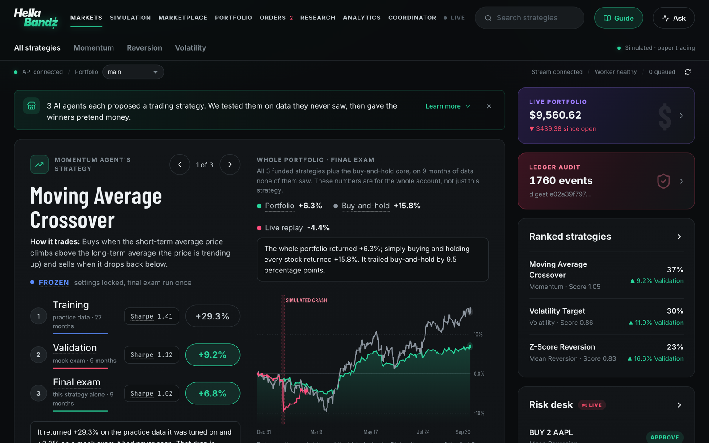
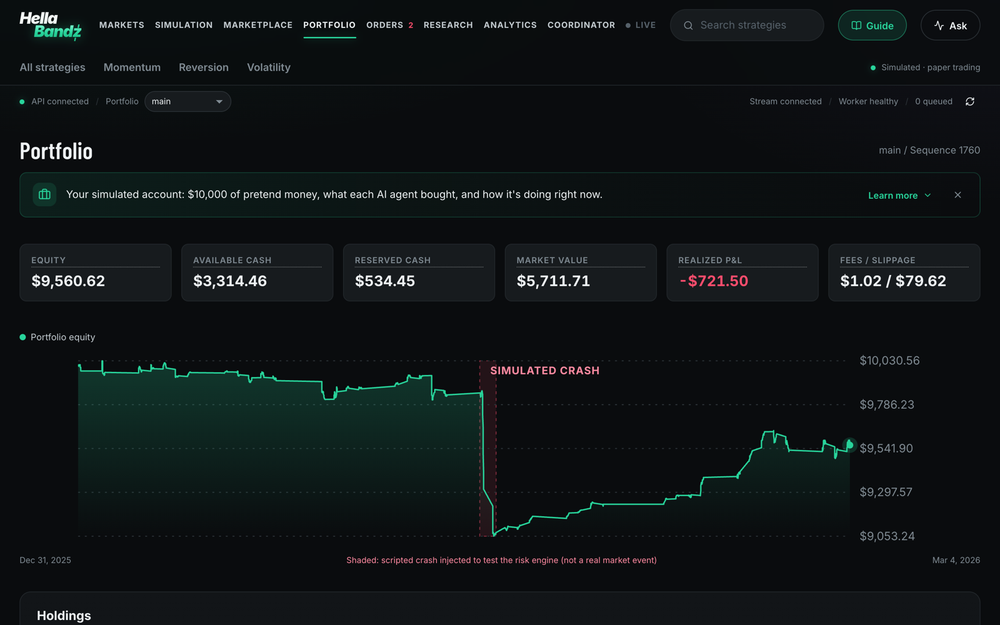
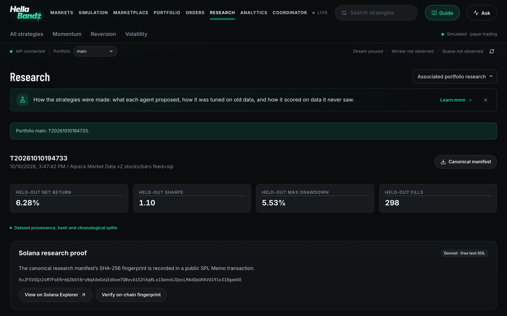
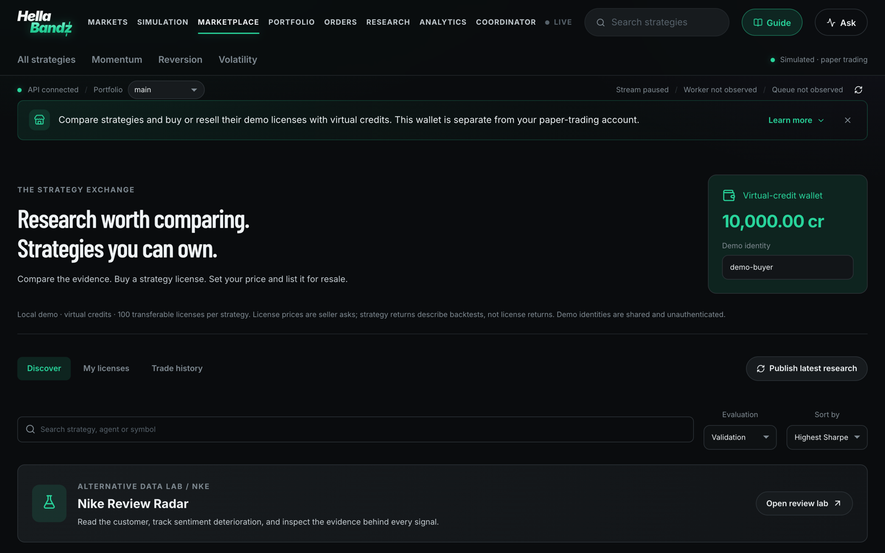
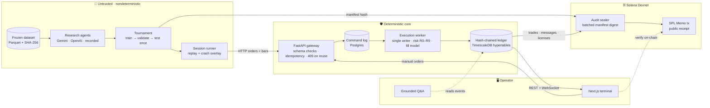

<div align="center">


# HellaBandz

### Autonomous AI trading agents on top of infrastructure they can't break

*LLM agents research markets, compete in an out-of-sample tournament, and trade a shared $10,000 paper portfolio.
A deterministic, single-writer execution engine decides what actually happens to the money, and every trade is sealed on Solana.*

<br />


<br /><br />

[](https://www.python.org/)
[](https://fastapi.tiangolo.com/)
[](https://solana.com/)
[](https://www.timescale.com/)
[](https://www.postgresql.org/)
[](https://nextjs.org/)
[](https://react.dev/)
<br />
[](https://ai.google.dev/)
[](https://platform.openai.com/)
[](https://www.anthropic.com/)
[](https://docs.docker.com/compose/)
[](https://hypothesis.readthedocs.io/)
[](docs/SUBMISSION.md)

<br />

🏁 Built at **HackRU Fall 2026** · Rutgers University · Lucera Trading Systems Challenge · Tiger Data · Solana

[**Judge demo**](docs/JUDGE_DEMO.md) · [**How it works**](docs/UNDERSTANDING_HELLABANDZ.md) · [**Architecture**](docs/ARCHITECTURE.md) · [**Invariants**](docs/INVARIANTS.md) · [**Performance**](docs/PERFORMANCE.md)

</div>

---

## 💸 Overview

HellaBandz lets AI agents run a trading desk without trusting them with the keys. Three LLM research agents
(momentum, mean reversion, volatility) each propose a strategy. The strategies are tuned on old data, ranked on
data they never saw, and the winners get pretend money. Everything an agent says is treated as untrusted input.

> **Agents propose. The engine disposes.** A deterministic, single-writer worker owns every dollar. It enforces
> risk limits, simulates fills, and keeps a hash-chained ledger that survives duplicate requests, concurrent
> clients, malformed input, and `kill -9`.

1. **Research.** Gemini-powered agents (OpenAI fallback, or recorded proposals offline) read a frozen dataset and pick strategy parameters. They never ship code.
2. **Compete.** A tournament fits on *train*, ranks on *validation*, allocates capital, then runs the *test* split exactly once.
3. **Trade.** Frozen strategies replay the held-out market through the API, including a scripted crash at 50%.
4. **Enforce.** Ten risk rules (R0–R9) approve, reduce, or reject every order before it touches the ledger.
5. **Prove.** Every event is SHA-256 chained, replayable bit-for-bit, and sealed on **Solana Devnet** with a public SPL Memo receipt.

All trading uses simulated orders and virtual funds. Market data is a committed synthetic fixture or historical
bars from Alpaca / Binance.

---

## ✨ Highlights

| | |
|---|---|
| ⛓️ **Solana audit seals** | Trades, agent messages, research manifests and marketplace sales are committed to Solana Devnet. Anyone can verify the on-chain fingerprint. |
| 🛡️ **Unbreakable ledger** | Idempotent commands, single writer per portfolio, hash-chained events. No sequence of duplicate, concurrent, or crashed commands can create cash from nothing. |
| 🤖 **Agent tournament** | Train → validate → allocate → test once. Unearned capital stays in a passive core, never idle cash. |
| ⚡ **Microsecond risk checks** | Pre-trade risk check p50 **1.8 µs**. Durable order path **482 orders/s** at 50 concurrent clients. |
| 💥 **Crash recovery** | SIGKILL the worker mid-session. Orders queue in Postgres, then the worker replays, verifies its digest, and resumes. |
| 🏪 **Strategy marketplace** | Compare frozen returns, Sharpe and drawdown. Buy and resell strategy licenses with virtual credits. |
| 👟 **Nike Review Radar** | Alternative-data lab that turns dated customer reviews into sentiment signals, with evidence shown for each one. |
| 💬 **Ask anything** | Read-only Q&A grounded in the live ledger and research runs, so answers cite real events. |

---

## 📸 Screenshots

<div align="center">


<sub><b>Markets.</b> Each agent's strategy through training, validation and the final exam, with live portfolio, ledger audit and risk desk.</sub>

<br /><br />

<table>
<tr>
<td width="50%"></td>
<td width="50%"></td>
</tr>
<tr>
<td align="center"><sub><b>Portfolio.</b> Equity, cash reservations and P&amp;L through a scripted market crash.</sub></td>
<td align="center"><sub><b>Research.</b> Held-out results, sealed with an on-chain Solana fingerprint.</sub></td>
</tr>
<tr>
<td colspan="2"></td>
</tr>
<tr>
<td colspan="2" align="center"><sub><b>Marketplace.</b> Compare the evidence, buy a strategy license, list it for resale.</sub></td>
</tr>
</table>

</div>

---

## 🏗️ Architecture



**Money never waits on a model.** Agents decide *what* to propose; the worker decides *what happens*.
LLM output only ever reaches the ledger as an ordinary, validated HTTP order.

<details>
<summary><b>Life of one order</b></summary>

1. An agent (or the UI) posts `OrderRequest{client_order_id, agent_id, symbol, side, qty, type, limit, signal_bar_ts}`.
2. The API inserts `commands(command_id="<portfolio>:order:<client_order_id>")`. A retry hits `ON CONFLICT` and returns the original decision; the same id with a new payload returns **409**.
3. The worker claims the command and runs risk rules R0–R9. Outcome is APPROVE, REDUCE, or REJECT, and it is recorded as an event either way.
4. On the next bar, the fill model fills at the open ± slippage (capped at 1% of bar volume). Leftovers expire after 5 bars.
5. Events, response, projections and the new state digest commit in **one transaction**, then `NOTIFY cmd_done`.

</details>

<details>
<summary><b>Risk rules R0–R9</b></summary>

| Rule | Check | Action |
|---|---|---|
| R0 | Portfolio must be open | reject |
| R1 | Order value ≤ 25% of equity | reduce to fit |
| R2 | Agent exposure + open buys ≤ agent allocation | reduce / reject |
| R3 | Market value + open buys ≤ 90% of equity | reduce |
| R4 | Cost + fees ≤ unreserved cash | reduce |
| R5 | Sell ≤ agent's unreserved position (no shorting) | reduce / reject |
| R6 | Valid qty, known symbol, sane limit price | reject |
| R7 | Signal not from the future and ≤ 2 hours stale | reject |
| R8 | Duplicate `client_order_id` returns the original decision | no new effect |
| R9 | Kill switch (manual, or auto at 15% drawdown) blocks buys | reject |

</details>

---

## ⛓️ Why Solana

Proving a ledger is honest to yourself is easy. Proving it to someone else is the hard part.

- **Research proofs.** Each tournament's canonical manifest is hashed and written to Devnet as an SPL Memo. `make verify-solana` reads it back and compares fingerprints.
- **Full-trace seals.** A periodic sealer batches 16 record sets (commands, ledger events, fills, agent messages, marketplace trades, review analyses and more) into a single digest and commits it on-chain.
- **Independent verification.** The **Audit** tab pins the trusted public signer, fetches the latest finalized proof, rebuilds the matching database snapshot, and downloads a receipt.
- **Privacy by design.** Only digests leave the machine. Raw records and signing keys stay local.

A seal proves record integrity, not strategy quality. Changes after the latest seal stay marked provisional.

---

## 🚀 Quickstart

**Requirements:** Docker (Desktop or Colima), [uv](https://docs.astral.sh/uv/), Node 20+, GNU make.
No API keys needed: the repo ships a committed dataset and recorded agent proposals.

```bash
make setup        # uv sync + npm ci
make up           # TimescaleDB + worker + API + terminal (resource-limited containers)
make tournament   # agents → fit on train → rank on validation → allocate → held-out test
make session      # replay the held-out period through API → worker, with a crash at 50%
```

Open **http://localhost:3000** (API on `:8000`). The first `make up` builds images and takes a few minutes.

<details>
<summary><b>Break it on purpose</b></summary>

```bash
make crash-worker     # SIGKILL the worker mid-session; orders keep queueing (HTTP 202)
make restart-worker   # replays the hash chain, verifies the digest, resumes, prints /v1/verify
make prove            # full test suite + invariant evidence table (≈2.5 min, needs `make up`)
make prove-docker     # same, inside a Linux container (use on Windows)
make bench            # benchmarks, then regenerate docs/PERFORMANCE.md
make reset up tournament session   # wipe the DB volume and run the whole pipeline again
```

</details>

<details>
<summary><b>Solana audit</b></summary>

```bash
make solana-commit verify-solana   # manifest hash → Devnet memo, then read it back and verify
make audit-init                    # pin a local Devnet wallet in .env (fund it from the faucet)
make backend audit-up              # periodic full-trace seals of trades, messages and licenses
```

Then open **Audit** in the terminal to verify the latest finalized proof.

</details>

<details>
<summary><b>Optional keys</b></summary>

Set these in `.env` (see [`.env.example`](.env.example) and [INTEGRATIONS](docs/INTEGRATIONS.md); `make check-integrations` shows status):

| Key | Unlocks |
|---|---|
| `GEMINI_API_KEY` | Live research agents, supervisor, crisis responses (default provider) |
| `OPENAI_API_KEY` | Fallback LLM provider |
| `ANTHROPIC_API_KEY` | Claude text classifier for Nike Review Radar |
| `ALPACA_API_KEY_ID` / `ALPACA_API_SECRET_KEY` | Real equity bars |
| `QS_AUTH_REQUIRED=1` | Operator sign-in with `QS_API_TOKEN` ([Security](docs/SECURITY.md)) |

</details>

---

## 🎯 The 10 questions

Answers to the Lucera Trading Systems starter-guide outline.

| | |
|---|---|
| **User and problem** | A desk letting autonomous agents propose trades needs a hard boundary that keeps a buggy or overconfident agent from overspending, double-filling, shorting, or corrupting the books. |
| **Core claim** | No sequence of duplicated, concurrent, malformed, delayed, or crash-interrupted commands can create cash or shares from nothing or apply a fill twice. The ledger can always be rebuilt bit-for-bit from its event log. |
| **Boundary** | Bar-based simulated fills (no order book), long-only cash account, 5 symbols, single-operator auth. See [LIMITATIONS](docs/LIMITATIONS.md). |
| **Correctness** | 12 invariant categories: idempotency, cash/position safety, risk enforcement, fill validity, determinism, accounting identity, recovery, causality, audit integrity, ordering, operator access. See [INVARIANTS](docs/INVARIANTS.md). |
| **Evidence** | Unit, property-based (random command programs checked after every step), real-Postgres concurrency, SIGKILL fault injection, tamper detection. `make prove` prints the table. |
| **Interfaces** | HTTP API ⇄ Postgres command log ⇄ execution worker. Agents and UI are just API clients. See [ARCHITECTURE](docs/ARCHITECTURE.md). |
| **Measurement** | Risk-check latency, durable throughput at 1/10/50 clients, replay of 131k real Binance bars, recovery time vs ledger size, all under fixed container limits. See [PERFORMANCE](docs/PERFORMANCE.md). |
| **Failure behavior** | Invalid ⇒ 422 or recorded rejection. Duplicate ⇒ original decision. Same id, new payload ⇒ 409. Stale signal ⇒ R7. Worker down ⇒ commands queue (202) and drain in order. Corrupted checkpoint ⇒ worker refuses to start. |
| **Reproduction** | The Quickstart above. No API keys needed. |
| **Next limit** | Shard portfolios, profile position/fill scans, archive growing event and retry histories. |

---

## 📊 By the numbers

| Metric | Result |
|---|---|
| Pre-trade risk check | **1.8 µs** p50 · 3.1 µs p99 |
| Durable order path (50 clients) | **482 orders/s** · 168 ms p99 |
| Single-client order latency | **9.0 ms** p50 |
| Crash recovery (105k-event ledger) | **0.44 s** · container ready in 2.0 s |
| Backtest replay (131k Binance bars) | **37,916 bars/s** |
| Event-log replay | **96,308 events/s** |

Measured with fixed limits: 1 vCPU worker, 1 vCPU API, 2 vCPU database. These are a historical baseline from before
operator auth and full-trace auditing were added; run `make bench` for fresh numbers.

---

## 🗂️ Repository map

```
hellabandz/
  contracts/      versioned Pydantic schemas (orders, bars, commands, proposals, specs)
  ledger/         ★ pure deterministic core: state, events, risk rules, fill model, invariants, replay
  execution/      single-writer worker, job manager, Postgres/Timescale schema
  api/            FastAPI gateway: idempotent intake, read models, verify, WebSocket stream
  backtester/     DataProvider + frozen strategy slots over the same core
  strategies/     whitelisted causal strategy families (agents pick parameters, never code)
  ingestion/      snapshot format, validation, content hashing, synthetic generator
  agents/         research pipeline, tournament, live session runner, grounded Q&A, reviews
  audit/          Solana Devnet memo commitments, full-trace sealer and verifier
apps/web/         Next.js trading terminal
tests/            unit · property · integration (real Postgres) · recovery (SIGKILL)
benchmarks/       workload generator, runners, report → docs/PERFORMANCE.md
scripts/          fixtures, Alpaca/Binance ingestion, prove.py, browser smoke check
data/             committed synthetic dataset, recorded proposals, hash-committed manifests
```

---

## 🧰 Built with

| Layer | Tools |
|---|---|
| **Blockchain** | Solana Devnet, SPL Memo program, `solders`, Solana JSON-RPC |
| **Storage** | PostgreSQL 16 + TimescaleDB 2.17 (Tiger Data): command log, ledger, hypertables |
| **Backend** | Python 3.12, FastAPI, Uvicorn, Pydantic v2, psycopg 3 |
| **AI** | Gemini (default), OpenAI (fallback), Claude (review classifier) |
| **Quant** | NumPy, PyArrow, Binance public archive, Alpaca Market Data API |
| **Frontend** | Next.js 15, React 19 |
| **Testing** | pytest, Hypothesis, Playwright browser smoke |
| **Infra** | Docker Compose with per-service CPU and memory limits |

**Built during HackRU:** everything under `hellabandz/`, `apps/web/`, `tests/`, `benchmarks/`, `scripts/`,
the synthetic dataset generator, the schema, the docs, and the recorded fixture proposals.

---

## 📚 Docs

[Understanding HellaBandz](docs/UNDERSTANDING_HELLABANDZ.md) · [Judge demo](docs/JUDGE_DEMO.md) ·
[Architecture](docs/ARCHITECTURE.md) · [Invariants](docs/INVARIANTS.md) · [Performance](docs/PERFORMANCE.md) ·
[Security](docs/SECURITY.md) · [Verification](docs/VERIFICATION.md) · [Adaptive research](docs/ADAPTIVE_RESEARCH.md) ·
[Coordinated trading](docs/COORDINATED_TRADING.md) · [Simulation](docs/SIMULATION.md) · [Marketplace](docs/MARKETPLACE.md) ·
[Strategy evaluation](docs/STRATEGY_EVALUATION.md) · [Data sources](docs/DATA_SOURCES.md) · [Integrations](docs/INTEGRATIONS.md) ·
[Limitations](docs/LIMITATIONS.md) · [Submission](docs/SUBMISSION.md)

---

<div align="center">

### 👥 Team

[**@AryanSingh103**](https://github.com/AryanSingh103) · [**@dsun-1**](https://github.com/dsun-1) · [**@KrishMaske**](https://github.com/KrishMaske)

<sub>Made with 💚 and too much caffeine at HackRU Fall 2026. Paper trading only: no real money was harmed.</sub>

</div>
